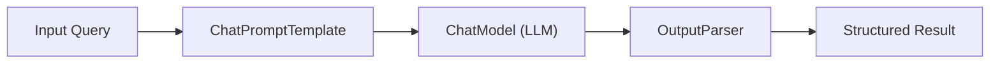
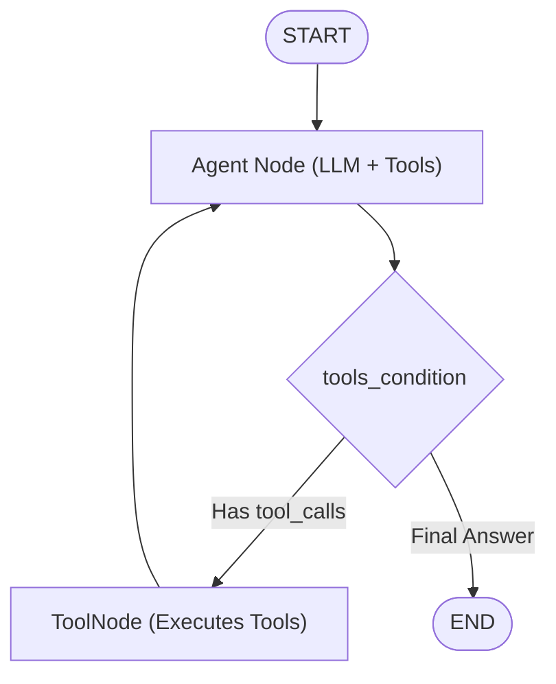
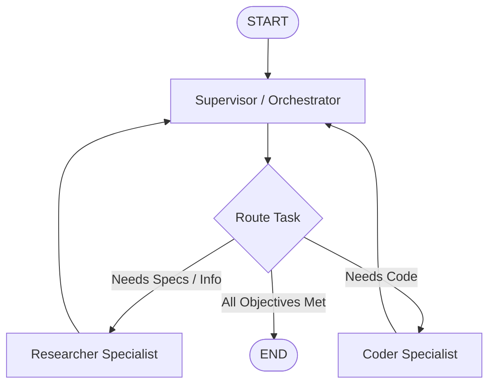

# 🦜🕸️ LangChain & LangGraph: The Comprehensive Explanation & Code Guide

> A production-ready, hands-on architectural guide and code repository demystifying **LangChain** and **LangGraph** — from fundamental prompt pipelines to stateful, cyclical, multi-agent autonomous systems.

---

## 📑 Table of Contents

- [The Big Picture: LangChain vs. LangGraph](#-the-big-picture-langchain-vs-langgraph)
- [Architectural Comparison](#-architectural-comparison)
- [Visual Architecture Diagrams](#-visual-architecture-diagrams)
  - [LangChain: Linear Pipeline (DAG)](#1-langchain-linear-pipeline-dag)
  - [LangGraph: Stateful ReAct Cycle](#2-langgraph-stateful-react-cycle)
  - [LangGraph: Multi-Agent Supervisor Pattern](#3-langgraph-multi-agent-supervisor-pattern)
- [Repository Structure](#-repository-structure)
- [Getting Started & Installation](#-getting-started--installation)
- [Curriculum & Code Walkthrough](#-curriculum--code-walkthrough)
  - [Module 01: LangChain Fundamentals](#module-01-langchain-fundamentals)
  - [Module 02: LangChain Agents & Tools](#module-02-langchain-agents--tools)
  - [Module 03: LangGraph Fundamentals](#module-03-langgraph-fundamentals)
  - [Module 04: LangGraph Agents & Cycles](#module-04-langgraph-agents--cycles)
  - [Module 05: Advanced LangGraph](#module-05-advanced-langgraph)
- [When to Choose Which?](#-when-to-choose-which)
- [License](#-license)

---

## 🌟 The Big Picture: LangChain vs. LangGraph

Modern LLM development has shifted dramatically:

```
┌────────────────────────────────────────────────────────┐
│                      LangChain                         │
│   Linear Chains, Prompt Templates, Parsers, Simple RAG  │
│                   (A -> B -> C -> Done)                │
└──────────────────────────┬─────────────────────────────┘
                           │
                 Evolved & Extended By
                           │
                           ▼
┌────────────────────────────────────────────────────────┐
│                      LangGraph                         │
│  Stateful Agents, Loops/Cycles, Human-in-the-Loop,     │
│       Multi-Agent Collaboration, Time-Travel           │
└────────────────────────────────────────────────────────┘
```

1. **LangChain** excels at **linear composition**:
   - Creating prompt templates.
   - Standardizing LLM client connections (OpenAI, Gemini, Anthropic, Ollama).
   - Document loaders, chunkers, and basic RAG pipelines.
   - Chaining components via **LCEL** (`prompt | model | parser`).

2. **LangGraph** extends LangChain by introducing **state machines & cyclic graphs**:
   - True loops (an agent inspects its output, detects a mistake, and retries).
   - First-class centralized **State** with reducer functions (`operator.add`, `add_messages`).
   - Built-in **Persistence & Checkpointing** (`MemorySaver`, `SqliteSaver`, `PostgresSaver`).
   - Native **Human-in-the-Loop** breakpoints (pause for approval before dangerous actions).
   - Complex **Multi-Agent Orchestration** (Supervisors, Hierarchical teams, Swarms).

---

## ⚖️ Architectural Comparison

| Dimension | LangChain (LCEL / Chains) | LangGraph (StateGraph) |
| :--- | :--- | :--- |
| **Execution Topology** | **DAG** (Directed Acyclic Graph) — strictly unidirectional | **Cyclic Graph** — supports loops, retries, and state transitions |
| **State Handling** | Transient; passed forward through dictionary piping | **First-Class Shared State** schema with custom reducer functions |
| **Agent Paradigm** | `AgentExecutor` (rigid, black-box loop) | Explicit **StateGraph** with custom nodes and `ToolNode` |
| **Persistence** | Basic memory classes (e.g. `ConversationBufferMemory`) | **Checkpointer snapshots** at every node transition |
| **Human Approval** | Cumbersome to interrupt and resume | Native `interrupt_before`, `interrupt_after`, and `interrupt()` |
| **Multi-Agent Teams** | Difficult to coordinate cleanly | Built-in support for supervisor, broadcast, and network patterns |
| **Ideal For** | Document Q&A, structured extraction, static RAG pipelines | Autonomous coding agents, customer support bots, complex workflows |

---

## 📊 Visual Architecture Diagrams

### 1. LangChain: Linear Pipeline (DAG)


### 2. LangGraph: Stateful ReAct Cycle


### 3. LangGraph: Multi-Agent Supervisor Pattern


---

## 📁 Repository Structure

```text
.
├── 01_langchain_basics/
│   ├── README.md                          # In-depth LCEL & prompt concepts
│   ├── 01_prompts_and_models.py           # Prompts, ChatPromptTemplate, system/human roles
│   ├── 02_lcel_and_parsers.py             # Pipe operator (|), Str, Json, & Pydantic parsers
│   ├── 03_runnables_and_branching.py      # Passthrough, Parallel, Lambda, Branch
│   └── 04_simple_rag_pipeline.py          # Complete in-memory RAG pipeline
│
├── 02_langchain_agents/
│   ├── README.md                          # Tool definitions & legacy AgentExecutor concepts
│   ├── 01_custom_tools.py                 # @tool decorator & Pydantic args_schema
│   └── 02_react_agent_executor.py         # Multi-step tool-calling agent executor
│
├── 03_langgraph_fundamentals/
│   ├── README.md                          # StateGraph, Nodes, Edges, Reducers explained
│   ├── 01_basic_stategraph.py             # Minimal StateGraph: TypedDict, START, END
│   ├── 02_conditional_routing.py          # Dynamic routing & conditional edges
│   └── 03_state_reducers.py               # Overwrite vs operator.add vs add_messages
│
├── 04_langgraph_agents/
│   ├── README.md                          # Cyclic ReAct loop & ToolNode mechanics
│   ├── 01_langgraph_react_agent.py        # Custom cyclic ReAct graph from scratch
│   └── 02_prebuilt_create_react_agent.py  # Production prebuilt create_react_agent
│
├── 05_langgraph_advanced/
│   ├── README.md                          # Checkpoints, Human-in-the-loop & Multi-agent
│   ├── 01_persistence_and_checkpoints.py  # MemorySaver, thread_id, state snapshots
│   ├── 02_human_in_the_loop.py            # Breakpoints & operator approvals
│   └── 03_multi_agent_collaboration.py    # Supervisor pattern multi-agent workflow
│
├── .env.example                           # Template for API keys
├── requirements.txt                       # Project dependencies
├── LICENSE                                # MIT License
└── README.md                              # Main guide (this document)
```

---

## 🚀 Getting Started & Installation

### 1. Clone the repository
```bash
git clone https://github.com/Afzal-Iqbal/langchain-and-langgraph-explained.git
cd langchain-and-langgraph-explained
```

### 2. Set up virtual environment
```bash
python3 -m venv .venv
source .venv/bin/activate  # On Windows: .venv\Scripts\activate
```

### 3. Install dependencies
```bash
pip install -r requirements.txt
```

### 4. Configure environment variables (Optional)
Copy `.env.example` to `.env`:
```bash
cp .env.example .env
```
Add your OpenAI or Google Gemini API key:
```ini
OPENAI_API_KEY=your_key_here
# or
GOOGLE_API_KEY=your_gemini_key_here
```
> **Note**: Every example in this repository includes **zero-config simulated execution**. If you don't configure an API key, the scripts run with built-in mock responses so you can learn the data structures and flow immediately!

---

## 📖 Curriculum & Code Walkthrough

### Module 01: LangChain Fundamentals
Learn the foundation of LLM application architecture:
```python
from langchain_core.prompts import ChatPromptTemplate
from langchain_core.output_parsers import StrOutputParser

prompt = ChatPromptTemplate.from_template("Explain {topic} in one sentence.")
chain = prompt | model | StrOutputParser()
result = chain.invoke({"topic": "LangChain Expression Language"})
```
- Run: `python 01_langchain_basics/01_prompts_and_models.py`
- Run: `python 01_langchain_basics/02_lcel_and_parsers.py`
- Run: `python 01_langchain_basics/03_runnables_and_branching.py`
- Run: `python 01_langchain_basics/04_simple_rag_pipeline.py`

---

### Module 02: LangChain Agents & Tools
Define custom functions that models can call:
```python
from langchain_core.tools import tool

@tool
def calculate_area(width: float, height: float) -> float:
    """Calculates rectangle area."""
    return width * height
```
- Run: `python 02_langchain_agents/01_custom_tools.py`
- Run: `python 02_langchain_agents/02_react_agent_executor.py`

---

### Module 03: LangGraph Fundamentals
Assemble your first state machine using `StateGraph`:
```python
from langgraph.graph import StateGraph, START, END

builder = StateGraph(MyState)
builder.add_node("process", process_node)
builder.add_edge(START, "process")
builder.add_edge("process", END)
app = builder.compile()
```
- Run: `python 03_langgraph_fundamentals/01_basic_stategraph.py`
- Run: `python 03_langgraph_fundamentals/02_conditional_routing.py`
- Run: `python 03_langgraph_fundamentals/03_state_reducers.py`

---

### Module 04: LangGraph Agents & Cycles
Implement true cyclic loops with `ToolNode` and `tools_condition`:
```python
builder.add_node("agent", agent_node)
builder.add_node("tools", ToolNode(tools))

builder.add_edge(START, "agent")
builder.add_conditional_edges("agent", tools_condition)
builder.add_edge("tools", "agent")  # The loop!
```
- Run: `python 04_langgraph_agents/01_langgraph_react_agent.py`
- Run: `python 04_langgraph_agents/02_prebuilt_create_react_agent.py`

---

### Module 05: Advanced LangGraph
Enterprise features: Checkpoint persistence, approval breakpoints, and multi-agent coordination:
```python
from langgraph.checkpoint.memory import MemorySaver

# Checkpointed graph with human approval breakpoint before executing
app = builder.compile(
    checkpointer=MemorySaver(),
    interrupt_before=["execute_critical_action"]
)
```
- Run: `python 05_langgraph_advanced/01_persistence_and_checkpoints.py`
- Run: `python 05_langgraph_advanced/02_human_in_the_loop.py`
- Run: `python 05_langgraph_advanced/03_multi_agent_collaboration.py`

---

## 🎯 When to Choose Which?

```
Do you need loops, retries, or agents that correct their own work?
  ├── YES ──> Choose LangGraph
  └── NO
       │
       Does the workflow require pausing for human review or persistence across sessions?
         ├── YES ──> Choose LangGraph
         └── NO
              │
              Is it a linear pipeline (e.g. Prompt -> LLM -> Parse -> Save)?
                ├── YES ──> Choose LangChain (LCEL)
                └── NO  ──> Choose LangGraph
```

---

## 📄 License

This project is licensed under the MIT License - see the [LICENSE](LICENSE) file for details.
